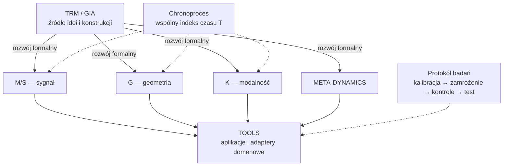

# GIA-TIMDR

<!-- TIMDR HUB LINKS -->
> **TIMDR — nawigacja:** [Knowledge Hub — dokumentacja i wyszukiwarka](https://jbackk-lang.github.io/TIMDR-AI-Knowledge-Base/) · [Panel badawczy i katalog repozytoriów](https://jbackk-lang.github.io/) · [GIA-TIMDR — źródła](https://github.com/jbackk-lang/GIA-TIMDR) · [Research AI — kod i uruchomienie lokalne](https://github.com/jbackk-lang/TIMDR-AI-Knowledge-Base). Publiczna wyszukiwarka Huba jest tekstowa; wyszukiwanie semantyczne działa lokalnie.
<!-- /TIMDR HUB LINKS -->

GIA-TIMDR to rozwijany przez J. S. Kielicha program badawczo-inżynierski: od pomysłu analizy zmiany przeszedł do czterech sformalizowanych gałęzi, działającego kodu, prerejestrowanych testów i zastosowań na rzeczywistych danych. Obejmuje **M/S** (sygnał), **G** (geometria), **K** (modalność) i **META-DYNAMICS** (agregat Λ–τ–ρ–J). Chronoproces daje trzem pierwszym wspólny nośnik czasu, zachowując odrębność operatorów. Starsza warstwa GIA/TRM pozostaje ważną częścią historii idei projektu.

## Architektura TIMDR

**TIMDR jest frameworkiem konstrukcyjnym rozwijanym z idei TRM/GIA.** Cztery gałęzie dostarczają odrębnych języków matematycznych do opisu sygnału, geometrii, modalności i dynamiki agregatowej. Chronoproces umożliwia wspólny opis czasowy M/S, G i K, a narzędzia domenowe wykorzystują wybrane operatory do konkretnych zadań.

TRM/GIA stanowią źródło idei i konstrukcji całego ekosystemu. Strzałki „rozwój formalny” na diagramie pokazują tę genealogię. [Konstrukcja referencyjna v0.1](docs/theory/TIMDR_EventGraph_Branch_Construction.md) dodaje jawne odwzorowania z grafu zdarzeń do sygnału, krzywej, widma oraz stanu META, wraz z kodem i 17 testami syntetycznymi. Jest pierwszym formalnym krokiem łączącym tę genealogię z reprezentacjami gałęzi; pełne wyprowadzenie wszystkich aksjomatów wymaga dalszej pracy.

W [Chronoprocesie Ξ=(T,x,Γ,φ)](docs/theory/TIMDR_Chronoprocess.md) φ opisuje reprezentację modalną w czasie. Chronoproces koordynuje M/S, G i K; aplikacja korzystająca z jednej gałęzi może używać jej bezpośrednio. Własności operatora GIA, takie jak monotoniczność, stabilność i zbieżność, wymagają określenia mierzonej wielkości oraz warunków ich zachodzenia.

Pełny autorski szkic warstw i zastosowań: [ARCHITEKTURA_TIMDR.md](https://github.com/jbackk-lang/GIA-TIMDR/blob/main/ARCHITEKTURA_TIMDR.md).

Szczegóły nowych odwzorowań: [sygnał — binning, normalizacja i wygładzanie](docs/theory/TIMDR_Signal_From_EventGraph.md) oraz [geometria — krzywa, wstęga i rura](docs/theory/TIMDR_Geometry_From_EventGraph.md). Przykład uruchomisz z katalogu repo poleceniem `python -m core.trm_gia_projections` (Python z NumPy).

## TIMDR jako zasada: od rdzenia do systemu

TIMDR to zasada budowania małego rdzenia, z którego można wyprowadzić mechanizm interpretacji, działania i samokorekty. Cztery gałęzie formalne są jej matematycznym zapisem, a pozostałe projekty ekosystemu powstały z tej samej zasady w różnych dziedzinach. Najdalej rozwija ją system złożony z trzech warstw:

| Warstwa | Rola |
|---|---|
| **TIMDR** (to repozytorium) | Dostarcza zasady: rdzeń, protokół badań, kryteria prawdziwości wyniku |
| [**AI-SI-TSI**](https://github.com/jbackk-lang/AI-SI-TSI) | Interpretuje dane, dobiera narzędzie i weryfikuje wyniki w obsługiwanych zadaniach |
| [**Aplikacje TSI**](#tsi-i-zastosowania-timdr) | Stosują wspólne mechanizmy w zadaniach domenowych, od matematyki i budżetu po eksperymentalną analizę sygnałów |

Skuteczność oceniamy osobno dla każdej aplikacji i zadania. Wyniki i zakres zastosowania podają repozytoria domenowe.

## Co już powstało

- Cztery gałęzie opisane definicjami i aksjomatami (13 M/S, 10 G, 10 K, 9 META), cztery formalne repozytoria włączone tutaj z zachowaniem historii oraz kod geometrii, sygnału, fazy i dynamiki.
- Mosty między gałęziami sprawdzone na syntetyce i danych rzeczywistych. MC M/S↔G uzyskał 140/240 kombinacji testowych, w tym Gi 30/30 dla łożysk; B4-Kitchen ma dwa wyniki SUPPORTED w dwóch sesjach jednego uczestnika.
- Samodzielne narzędzia domenowe: m.in. [fusion-tools](https://github.com/jbackk-lang/TIMDR-fusion-tools) (19/19 nowych strzałów TCABR w teście czasu zaniku prądu), synoptyki z pomiarem błędu prognoz, analiza łożysk, monitoring sieci i sejsmika.
- Protokół z prerejestracją, kontrolami, zamrożeniem danych i jawnym zapisem wyników pozytywnych, częściowych oraz negatywnych. Dzięki temu poszczególne twierdzenia można oceniać i replikować, zamiast przyjmować całą koncepcję na wiarę.

To konkretne osiągnięcia w opisanych danych i wersjach. GIA-TIMDR nie przedstawia jeszcze jednej potwierdzonej teorii wszystkich zjawisk; szczegółowy stan i zakres wyników podaje [stan projektu](STAN_PROJEKTU.md).

## TSI i zastosowania TIMDR

[AI-SI-TSI](https://github.com/jbackk-lang/AI-SI-TSI) to lokalny system łączący własny model językowy, gramatykę GF, pamięć, reguły logiczne i narzędzia do obliczeń oraz analizy sygnałów. W projektach domenowych może działać jako mały wykonawca z własnym wejściem i określonym zakresem decyzji. Wdrożony moduł odpowiedzi ma **9,07 mln parametrów**. Konsultacja z zewnętrznym AI jest opcjonalna.

| Projekt | Zastosowanie |
|---|---|
| [TSI Math Validator](https://github.com/jbackk-lang/TSI-math-validator-5) | Nauka matematyki, przeliczenia, zadania i audyt kroków rozwiązania. |
| [TSI-MUZ](https://github.com/jbackk-lang/TSI-MUZ) | Budżet, odczyt dokumentów, przypomnienia i raporty. |
| [TSI Predikt Motor](https://github.com/jbackk-lang/TSI-Predikt-Motor) | Wersja badawcza analizy OBD-II i nagrań pracy silnika. Na FordA profil wykrył 618/639 przypadków klasy dodatniej i wskazał 29/681 przebiegów klasy kontrolnej. |
| [TIMDR-Grid-Monitor](https://github.com/jbackk-lang/TIMDR-Grid-Monitor) | W odtworzeniu symulacji PROTECT-90 profil wskazał 505/512 zwarć w ciągu 80 ms, a reguła spadku napięcia 501/512. |
| [TIMDR-Earthquake-Core](https://github.com/jbackk-lang/TIMDR-Earthquake-Core) | Sejsmika i badania detekcji nadejścia fali P |
| [TIMDR-Tornado-NEXRAD](https://github.com/jbackk-lang/TIMDR-Tornado-NEXRAD) | Rotacja w skanach Dopplera i próby lokalizacji wiru przy ograniczonej ilości danych |
| [TSI Predikt Motor](https://github.com/jbackk-lang/TSI-Predikt-Motor) i [TIMDR EV Predict](https://github.com/jbackk-lang/TIMDR-EV-Predict) | Diagnostyka sygnałów z napędu i badania kondycji akumulatora |
| [TIMDR Solar PV](https://github.com/jbackk-lang/TIMDR-Solar-PV) | Analiza pracy instalacji fotowoltaicznych |
| [TIMDR-Tornado-NEXRAD](https://github.com/jbackk-lang/TIMDR-Tornado-NEXRAD) | Badanie rotacji w danych Dopplera. Przy wejściu 68 KiB wir znalazł się wśród trzech pierwszych kandydatów w 1/6 przypadków bez podania lokalizacji. |

Wyniki dotyczą podanych zbiorów i wersji. Sejsmika i radar pogodowy pozostają pracami badawczymi. Odrębny kierunek analizy obrazu i wideo rozwija [MAGE-IN-IMAGE-DECODER](https://github.com/jbackk-lang/MAGE-IN-IMAGE-DECODER). Dokumentacja TSI jest publiczna. Aktualny kod, wagi i prywatna pamięć TSI pozostają lokalnie. [Wcześniejszy etap AI-SI](HISTORIA_README.md#dawne-lokalne-ai-si--stan-z-8-października-2026)

## Zacznij tutaj

- [TSI i zastosowania TIMDR](#tsi-i-zastosowania-timdr) — lokalny system, walidator matematyczny, MUZ i badania sygnałów.
- [Notatki i spostrzeżenia z 26–27 września 2026](docs/NOTATKI_2026-09-27.md) — idee autora, wyniki i przewidywania zapisane przed testem turbiny.
- [Drogowskazy TIMDR — jak zbudować program analizujący sygnał](docs/DROGOWSKAZY_TIMDR.md) — kroki pole → rezonans → sito → samokorekta → geometria → test, z przykładem sita rezonansowego dla łożysk.
- [Indeks archiwum](docs/archiwum/README.md) — historia projektu, datowane podsumowania, audyty i zachowane zestawienia wyników.
- [Mapa repozytorium](REPOZYTORIUM.md) — gdzie znajduje się kod, dokumentacja, prerejestracje i wyniki.
- [Stan projektu](STAN_PROJEKTU.md) — czym TIMDR jest dziś, zasady potwierdzone testami, najmocniejsze wyniki, zastosowania i bilans wszystkich testów (odświeżany jednym poleceniem). Poprzednie podsumowania i migawki: [indeks archiwum](docs/archiwum/README.md).
- [Specyfikacja czterech gałęzi](docs/theory/TIMDR_Branch_Specification.md) i [słownik](docs/GLOSSARY_EN_PL.md) — właściwe definicje oraz granice między obiektami.
- [Reguła kalibracji, zamrożenia i testu końcowego](docs/theory/TIMDR_CALIBRATION_FREEZE_RULE.md) — rozwój na train/calibration jest dopuszczony, tuning do wyniku holdoutu nie.
- [Pełny katalog ekosystemu](https://github.com/jbackk-lang/jbackk-lang.github.io/blob/main/KATEGORIE.md) — lista repozytoriów aplikacyjnych i koncepcyjnych; poniżej wymieniono tylko najbliższe temu repo.
- [Historia dawnego README](HISTORIA_README.md) — pełny, zachowany opis koncepcyjny i kronika wcześniejszych prac. Nie jest aktualnym skrótem statusów.

## Formalizmy i kod

| Część | Główne miejsce | Zakres |
|---|---|---|
| M/S | [TIMDR-Math-Formalism](TIMDR-Math-Formalism/) | Operatory sygnałowe i protokół testowania |
| G | [TIMDR-Geometry-Formalism](TIMDR-Geometry-Formalism/) | Krzywizna i dyskretny operator Weingartena |
| K | [TIMDR-Modal-Formalism](TIMDR-Modal-Formalism/) | Częstotliwość, faza, modalność |
| Chronoproces | [TIMDR-Time-Formalism](TIMDR-Time-Formalism/) | Wspólny czas i jawnie ograniczony most Fouriera |
| META-DYNAMICS | [Aksjomaty META-1–META-9](docs/theory/Axioms_META_TIMDR.md), [kod źródłowy](https://github.com/jbackk-lang/TIMDR-META-DYNAMICS) | Wektor stanu Λ–τ–ρ–J i operator ewolucji; implementacje domenowe żyją także w innych repozytoriach |

Cztery katalogi `TIMDR-*-Formalism` zostały włączone przez `git subtree` z zachowaniem historii. Katalog [MAGE-IN-IMAGE-DECODER](MAGE-IN-IMAGE-DECODER/) jest jedynie kopią trzech modułów aplikacyjnych; pełne testy, dane i wyniki tego projektu są w jego własnym repozytorium.

## Jak interpretować wyniki

Test syntetyczny pokazuje, czy implementacja realizuje definicję. Nie dowodzi przydatności na realnych danych. Wynik realnego testu dotyczy konkretnej domeny, danych, wersji operatora i zamrożonych kryteriów. **SUPPORTED**, **NOT SUPPORTED** i **INCONCLUSIVE** są odrębnymi werdyktami; efekt o przeciwnym znaku nie staje się potwierdzeniem po zmianie hipotezy.

Na łożyskach CWRU mosty i metryki topologiczne dały silny sygnał diagnostyczny. Wielokanałowa chronomembrana utrzymała przewidywany kierunek efektu na nowym archiwum obrotów i uszkodzeń, choć ścisłe kryterium przeszło 2 z 3 okien. B4-Kitchen uzyskał dwa wyniki SUPPORTED dla dwóch sesji i przepisów jednego uczestnika. Te wyniki wyznaczają sensowne kierunki replikacji: inne urządzenia, domeny i uczestników. Sejsmika i BTC nie odtworzyły całego wzorca CWRU, a B4-Bearing bez zsynchronizowanej geometrii pozostaje nierozstrzygnięty. Szczegóły i dokładne liczby są w [stanie projektu](STAN_PROJEKTU.md) oraz parach `PREREG_*` / `RESULT_*` w [docs/geometry](docs/geometry/).

W osobnym projekcie aplikacyjnym [TIMDR-fusion-tools](https://github.com/jbackk-lang/TIMDR-fusion-tools) klasyfikator czasu zaniku prądu `is_fast_quench()` poprawnie rozpoznał 19/19 nowych strzałów tokamaka TCABR. Metryka portretu fazowego `phasespace_funnel_ratio()` osiągnęła na tych samych danych czułość 12/14 i swoistość 5/5. To konkretne wyniki dla TCABR, nie walidacja wszystkich gałęzi TIMDR ani dowód skuteczności na innym tokamaku: próby MAST bez etykiet pozwoliły opisać rozkład sygnału, lecz nie ocenić trafności klasyfikacji. Lej fazowy z fusion-tools był inspiracją dla późniejszych konstrukcji chronogeometrycznych, ale nie jest tym samym operatorem.

## Zakres badań i archiwum wyników

TIMDR jest ramą konstrukcyjną i protokołem badań, a nie jednym gotowym detektorem ani potwierdzoną teorią wszystkich zjawisk. Badania obejmują sygnały, geometrię, modalność i dynamikę oraz zastosowania m.in. w energetyce, diagnostyce plazmy, meteorologii, sejsmice, radarze, monitoringu konstrukcji, analizie obrazu, astronomii i systemach TSI.

| Obszar | Przykłady prac | Gdzie szukać szczegółów |
|---|---|---|
| **Podstawy matematyczne** | M/S, G, K, META-DYNAMICS, Chronoproces, odwzorowania grafu zdarzeń | [Specyfikacja gałęzi](docs/theory/TIMDR_Branch_Specification.md), [teoria](docs/theory/) |
| **Eksperymenty i replikacje** | Łożyska i przekładnie, mosty i budynki, radar, budżet, sygnały multimodalne | [Zestawienie historyczne](docs/archiwum/WYNIKI_EKSPERYMENTOW_MIGAWKA_README_2026-11-14.md), [wyniki i prerejestracje](docs/geometry/) |
| **Zastosowania naukowe** | Plazma TCABR, sejsmika, astronomia, fotometria, meteorologia | [Katalog ekosystemu](https://github.com/jbackk-lang/jbackk-lang.github.io/blob/main/KATEGORIE.md), [astronomia](docs/astronomy/ASTRONOMIA_2026-09-30.md) |
| **Narzędzia i AI** | AI-SI-TSI, walidacja matematyki, MUZ, MAGE, analiza sygnałów | [Zastosowania TSI](#tsi-i-zastosowania-timdr), [powiązane projekty](#powiązane-zastosowania) |
| **Historia i dokumentacja** | Geneza GIA/TRM, dawne opisy, datowane podsumowania i audyty | [Indeks archiwum](docs/archiwum/README.md), [historia README](HISTORIA_README.md) |

**Interpretacja wyników:** przejście testu syntetycznego nie jest walidacją na rzeczywistych danych; SUPPORTED, NOT SUPPORTED i INCONCLUSIVE pozostają odrębnymi ocenami. Wyniki łożyskowe stanowią jedną z linii badawczych, nie reprezentują całego programu. Dokładne liczby, porównania z metodami bazowymi, niepowodzenia i ograniczenia zachowano w [historycznej tabeli eksperymentów](docs/archiwum/WYNIKI_EKSPERYMENTOW_MIGAWKA_README_2026-11-14.md). Aktualne podsumowanie: [STAN_PROJEKTU.md](STAN_PROJEKTU.md).

## Astronomia i obserwacje — nowe aplikacje

[Podsumowanie wyników, zakres i kod](docs/astronomy/ASTRONOMIA_2026-09-30.md) · [snapshoty źródeł](applications/astronomy/README.md).

**TIMDR-orbital-tracker**: katalogowe orbity SGP4, pomiary i prototyp śledzenia. **TIMDR-lightcurve-fewshot**: mało etykiet, diagnostyka krzywych oraz zdjęcia FITS → fotometria → analiza. To konstrukcje aplikacyjne TIMDR, nie nowe prawa orbitalne. Pilot ATLAS: TIMDR 84,82%, bez sita 85,78%, klasyczne + RF 91,35% macro-F1; obecna adaptacja nie wykazała przewagi. Fotometria sprawdzona na symulacji; walidacja na rzeczywistych zdjęciach pozostaje otwarta.

## Powiązane zastosowania

To projekty zbudowane według zasady TIMDR: z małego rdzenia wyprowadzić mechanizm interpretacji, działania i samokorekty. Nie są kolejnymi gałęziami formalnymi. Ich wyniki, dane i ograniczenia opisują ich własne repozytoria:

| Projekt | Rola i obecna granica |
|---|---|
| [TIMDR-orbital-tracker](https://github.com/jbackk-lang/TIMDR-orbital-tracker) | Astronomia / śledzenie: SGP4 i kojarzenie pomiarów, publiczne elementy orbitalne; niezależne rzeczywiste pomiary pozycji jeszcze niezwalidowane |
| [TIMDR-lightcurve-fewshot](https://github.com/jbackk-lang/TIMDR-lightcurve-fewshot) | Astronomia / fotometria i klasyfikacja: OGLE, pilot ATLAS, interfejs zdjęć; brak przewagi obecnego sita, zdjęcia zwalidowane tylko syntetycznie |
| [synoptyk-v2.0](https://github.com/jbackk-lang/synoptyk-v2.0) | Korekta prognozy Open-Meteo, filtr falkowy i lokalny bias; nie tworzy własnego modelu pogody |
| [SYNOPTYK-ARCTIC](https://github.com/jbackk-lang/SYNOPTYK-ARCTIC) | Stacje polarne, backtest i pomiar bias/MAE; test proxy „rezonansu” nie miał jeszcze dostatecznej liczby zdarzeń |
| [Synoptyk-v3](https://github.com/jbackk-lang/Synoptyk-v3) | Pogoda jako pole przestrzenne z wektorami wiatru; wstępny pomiar bias/MAE opiera się na krótkim oknie i małej próbie |
| [TIMDR-fusion-tools](https://github.com/jbackk-lang/TIMDR-fusion-tools) | Diagnostyka sygnałów tokamaka; wyniki TCABR opisane wyżej, transfer klasyfikatora na MAST niezweryfikowany etykietami |
| [TIMDR-Industrial-Predict](https://github.com/jbackk-lang/TIMDR-Industrial-Predict) | Sygnały maszyn i demo łożysk CWRU; nie zastępuje pomiaru geometrii wymaganego przez B4-Bearing |
| [TIMDR-Grid-Monitor](https://github.com/jbackk-lang/TIMDR-Grid-Monitor) | Monitoring sygnałów sieci energetycznej i przykłady PROTECT-90 |
| [TIMDR-Earthquake-Core](https://github.com/jbackk-lang/TIMDR-Earthquake-Core) | Analiza sejsmiczna; wyniki pozytywne i negatywne dokumentowane w repo domenowym |
| [MAGE-IN-IMAGE-DECODER](https://github.com/jbackk-lang/MAGE-IN-IMAGE-DECODER) | Obraz i wideo; trzy moduły skopiowano tu pomocniczo, pełny projekt pozostaje osobno |
| [TIMDR-AI-Core](https://github.com/jbackk-lang/TIMDR-AI-Core) | Protokół epistemiczny i eksperymenty aktywacji; linia HARTH zamknięta bez przyrostu nad baseline'em w badanym ustawieniu |
| [AI-SI-TSI](https://github.com/jbackk-lang/AI-SI-TSI) | Lokalny system języka, pamięci, narzędzi i oceny odpowiedzi. Dawne AI-SI opisano w historii |
| [TSI-MUZ](https://github.com/jbackk-lang/TSI-MUZ) i [TSI Math Validator](https://github.com/jbackk-lang/TSI-math-validator-5) | Aplikacje wykorzystujące wspólną obsługę TSI w budżecie i nauce matematyki |
| [RADAR-TRACKING](https://github.com/jbackk-lang/RADAR-TRACKING) | Mały rdzeń śledzenia z oceną zmiany ruchu i porównaniem trzech wariantów; tylko symulacja, TIMDR nie jest zawsze najlepszy |
| [TIMDR-Radar-Module](https://github.com/jbackk-lang/TIMDR-Radar-Module) | Rdzeń analizy trajektorii (twisty, redukcja szumu) i dokładny przekrój radarowy kuli (Mie); wynik pola częstotliwości umiarkowany (−7,6% błędu), dla dronów gorszy |
| [TIMDR-Structural-Health](https://github.com/jbackk-lang/TIMDR-Structural-Health) | Rdzeń monitorowania konstrukcji (kotwica modalna, detektor nowości); testy wzorcowe, bez walidacji na rzeczywistej konstrukcji |

Pełniejszy spis, także projektów koncepcyjnych, jest w [katalogu ekosystemu](https://github.com/jbackk-lang/jbackk-lang.github.io/blob/main/KATEGORIE.md). Tabela nie rości sobie prawa do wyliczenia wszystkich repozytoriów.

Kod i dokumentacja są materiałem badawczym, nie certyfikowanym narzędziem diagnostycznym. Każda deklaracja przewagi wymaga niezależnych danych i porównania z metodami bazowymi.

„GIA używa PCA jako kroku pomocniczego. Sednem operatora jest selekcja rezonansowej trajektorii w grafie zdarzeń TRM/TIMDR.”

## Cytowanie i licencja

Wersjonowane prace autora są dostępne pod DOI: [gałąź sygnałowa](https://doi.org/10.5281/zenodo.22288541), [przegląd ekosystemu](https://doi.org/10.5281/zenodo.22788266), [widmo Laplasjanu na wstędze Möbiusa](https://doi.org/10.5281/zenodo.22812269), [dwie algebraiczne klasy spektralne komutatorów odbić graniastosłupa rombowego](https://doi.org/10.5281/zenodo.24210921). Zakres każdego wydania jest różny. Warunki korzystania z kodu określa [LICENSE](LICENSE).
