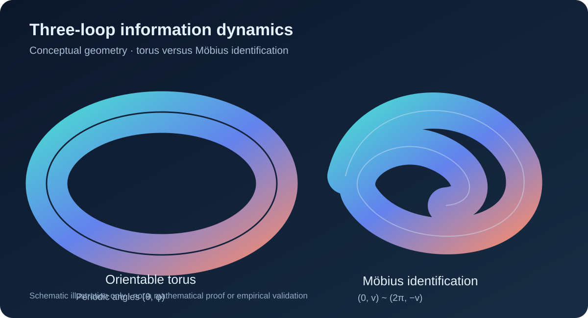

# Trójpętlowy model dynamiki informacyjnej na geometrii ze skręceniem — propozycja formalizacji

**Status:** model postulowany / hipoteza badawcza, nie aksjomat GIA-TIMDR i nie wynik walidacji empirycznej. **Gałąź:** G (geometria i topologia), z interfejsem do META-DYNAMICS (ewolucja stanu). **Inspiracja:** dostarczona wizualizacja trójpętlowej struktury oraz wzory Ψ, J(Λ), X/Y/Z. Ilustracja jest koncepcyjna, nie dowodzi topologii obiektu.



*Ilustracja porównawcza — schemat koncepcyjny, nie dowód matematyczny.*

> **Grafika źródłowa użytkownika:** „Topologiczne domknięcie strumienia informacji w strukturze toroidalnej” (PNG, przekazana w rozmowie). Plik źródłowy nie został jeszcze zapisany w repozytorium; po przesłaniu do `docs/theory/images/topologiczne_domkniecie_strumienia.png` należy osadzić go w tym miejscu. Schemat SVG powyżej jest odrębną ilustracją pomocniczą, nie kopią grafiki źródłowej.

**Dalsza formalizacja:** [twierdzenie o kontrakcji, holonomia wiązki i modele falsyfikacyjne](Three_Loop_Mobius_Spectral_And_Bundle_Extension.md).

## 1. Stan i przestrzeń fazowa

Dla dyskretnego kroku n∈ℤ definiujemy Ψ_n=(ψ₁,n,ψ₂,n,ψ₃,n)^T∈ℂ³ z normą ||Ψ||²=Σ|ψ_k|². ψ_k=a_k exp(iφ_k), a_k≥0. Przestrzeń ℂ³ jest **przestrzenią amplitud trzech kanałów**, a nie automatycznie przestrzenią Hilberta funkcji na taśmie Möbiusa. Nazwa H_Möbius wymagałaby osobnej definicji bazy, miary i warunków sklejenia.

Obserwable: moc I_n=Ψ_n†Ψ_n; udziały p_k=|ψ_k|²/I_n (dla I_n>0); entropia rozkładu S_n=−Σ_{p_k>0}p_k ln p_k; koherencja C_n=|Σ_k ψ_k|²/(3I_n)∈[0,1]. Te wielkości są **definicjami modelu**, a nie automatycznie entropią termodynamiczną ani energią fizyczną.

## 2. Operator zaproponowany w materiale

Ψ_{n+1}=J(Λ)Ψ_n, gdzie

```text
         [ 0    1   -Λ ]
J(Λ) =   [ -Λ   0    1 ]
         [ 1   -Λ    0 ]
```

Niech P=[[0,1,0],[0,0,1],[1,0,0]], P³=I. Wtedy J=P−ΛP². Jest to macierz cyrkulantowa; dla ω=exp(2πi/3) jej wartości własne to μ₀=1−Λ, μ₁=ω−Λω², μ₂=ω²−Λω. Dla rzeczywistego Λ:

ρ(J)=max(|1−Λ|, sqrt(1+Λ+Λ²)).

**Istotna korekta interpretacji:** dla Λ>0 mamy sqrt(1+Λ+Λ²)>1, więc operator J w tej postaci **nie jest tłumiący**; ogólnie wzmacnia pewne mody. Nie można na podstawie samej macierzy twierdzić, że Λ zapobiega rozpraszaniu energii lub stabilizuje układ. Ponadto znaki minus w macierzy nie dowodzą nieorientowalności przestrzeni geometrycznej.

### Wariant z kontrolą stabilności

Wprowadzamy jawny współczynnik γ≥0 i J_stab=exp(−γ)J(Λ)/s, gdzie s≥ρ(J) i s>0. Wtedy ρ(J_stab)≤exp(−γ)≤1. Ponieważ J jest normalna (wielomian unitarnej macierzy P), ||J_stab||₂=ρ(J_stab), zatem ||Ψ_{n+1}||₂≤exp(−γ)||Ψ_n||₂. Dla γ>0 uzyskujemy ścisłe tłumienie amplitudy. Alternatywnie dynamikę otwartą opisuje Ψ_{n+1}=J_stab Ψ_n+η_n, z jawnym modelem wymuszenia η_n. To **nowa propozycja**, nie oryginalna macierz użytkownika.

## 3. Skręt Möbiusa jako warunek sklejenia

Standardową wstęgę Möbiusa można parametryzować przez (u,v)∈[0,2π]×[−w,w] i utożsamienie (0,v)~(2π,−v). Jej zanurzenie w ℝ³:

F(u,v)=((R+v cos(u/2))cos u, (R+v cos(u/2))sin u, v sin(u/2)).

Warunek dla skalarnego pola na wstędze: f(u+2π,v)=f(u,−v). Dla pola z dodatkową wewnętrzną fazą dopuszczalny jest osobno zdefiniowany operator holonomii H, np. Ψ(u+2π,v)=HΨ(u,−v), o ile jest spójny z wybraną wiązką. **Inwersja orientacji geometrii nie oznacza automatycznie zmiany znaku każdej amplitudy.**

Trzy kanały można umieścić na jednej wstędze jako trzy pola ψ_k(u,v), albo zbudować graf trzech sprzężonych pętli z odrębnymi warunkami sklejenia. To dwie różne konstrukcje topologiczne — nie należy ich utożsamiać bez definicji.

## 4. Parametryzacja z materiału i jej zakres

Oryginalne równania:

X(θ,φ)=[R+r cos(3θ/2)]cos φ,
Y(θ,φ)=[R+r cos(3θ/2)]sin φ,
Z(θ,φ)=r sin(3θ/2).

Dla ustalonego θ i zmiennego φ otrzymujemy okrąg na stałej wysokości Z; dla θ i φ jest to **powierzchnia obrotowa** z trzykrotnie przebieganym przekrojem w zakresie θ∈[0,4π], a nie samodzielny dowód potrójnej wstęgi Möbiusa. Parametryzacja jest okresowa w θ z okresem 4π/3 i w φ z okresem 2π. Dla R>r>0 jej obraz jest standardowym torusem (przy odpowiednim zakresie parametrów), który jest **orientowalny**. Nie jest więc matematycznie poprawne nazywanie samego tego obrazu nieorientowalną wstęgą Möbiusa.

Dla regularnego torusa zwykle stosuje się niezależne kąty θ,φ:

T(θ,φ)=((R+r cos θ)cos φ,(R+r cos θ)sin φ,r sin θ).

Skręt nieorientowalny trzeba kodować przez **warunek sklejenia** (jak wyżej), nie przez sam czynnik 3/2 w argumencie funkcji trygonometrycznej. Nazwanie R „osią Λ” jest dodatkową interpretacją modelową: promień geometryczny R i parametr sprzężenia Λ mają różne role i jednostki.

## 5. Sprzężenie geometrii z dynamiką — wersja operacyjna

Definiujemy graf trzech kanałów z macierzą P i stanem Ψ_n. Geometrię opisujemy niezależnie przez F(u,v) oraz warunek sklejenia. Wybieramy obserwable topologiczne (np. parzystość transportu orientacji po obiegu) i dynamiczne (I_n,S_n,C_n). Dopiero **jawnie zdefiniowane** sprzężenie parametrów Λ=Λ(g_n), γ=γ(g_n) pozwala mówić o wpływie geometrii na ewolucję:

Ψ_{n+1}=J_stab(Λ(g_n),γ(g_n)) Ψ_n + η_n.

Przykładowa, falsyfikowalna hipoteza H1: przy identycznym wymuszeniu i normowaniu warunek sklejenia z odwróceniem v zmienia widmo odpowiedzi względem kontrolnego sklejenia orientowalnego. H0: brak różnicy po uwzględnieniu parametrów sprzężenia.

## 6. Testy konieczne przed uznaniem modelu za zweryfikowany

1. Test widma: porównać numerycznie wartości własne J z μ₀,μ₁,μ₂ i sprawdzić wzrost normy dla Λ>0.
2. Test stabilizacji: zweryfikować ||J_stab||₂≤exp(−γ) dla zakresu Λ i γ.
3. Test geometrii: policzyć normalną do T i sprawdzić jej globalną ciągłość (orientowalność torusa); osobno zweryfikować odwrócenie współrzędnej v w F.
4. Test identyfikowalności: rozróżnić efekty zmiany sprzężenia Λ od efektów warunku sklejenia.
5. Test empiryczny: określić dane, jednostki, sposób estymacji Ψ i Λ, predykcję, baseline oraz kryterium odrzucenia H0.

## 7. Granice twierdzeń i integracja

Ten dokument rozwija **propozycję** użytkownika, ale nie stanowi dowodu „topologicznego domknięcia strumienia informacji”, zachowania energii ani związku z entropią fizyczną. W szczególności trzy kule na wizualizacji nie wyznaczają liczby składowych przestrzeni stanów bez niezależnego założenia. Dokument jest przypisany do **G / geometrii i topologii**, a operator ewolucji ma interfejs do **META-DYNAMICS**. Nie zastępuje obowiązujących aksjomatów ani istniejącej implementacji geometrycznej.


## 8. Test całego przejścia trójpętlowego (2026-11-08)

Zgodnie z warunkiem badawczym, obiektem testu jest cały wektor `Ψ=(ψ₁,ψ₂,ψ₃)ᵀ` i relacje między jego składowymi podczas pełnego obiegu. Test pojedynczej składowej jest wyłącznie kontrolą pomocniczą.

- Protokół: [PHASE_RECOVERY_VALIDATION_PROTOCOL.md](PHASE_RECOVERY_VALIDATION_PROTOCOL.md)
- Eksperyment holonomii: [triple_loop_transition_probe.py](../../experiments/triple_loop_transition_probe.py)
- Testy: [test_triple_loop_transition_probe.py](../../tests/test_triple_loop_transition_probe.py)

W modelu kandydującym `H=P`, `P³=I`: po trzech obiegach kanały wracają do pierwotnego uporządkowania. Test numeryczny daje błąd domknięcia 0 w arytmetyce macierzowej. Jednak zaburzenie wprowadzone do stanu początkowego pozostaje po trzech obiegach (norma różnicy od stanu pierwotnego w przykładowym przebiegu: ok. 0,9142). **Domknięcie cyklu nie jest samonaprawą.** Wynik ten nie potwierdza jeszcze odzyskiwania sygnału ani informacji.

